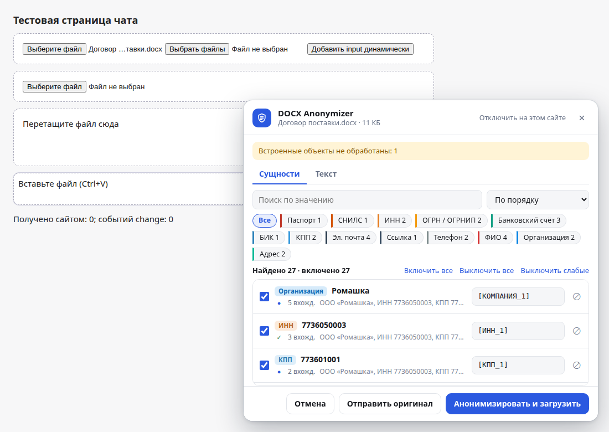
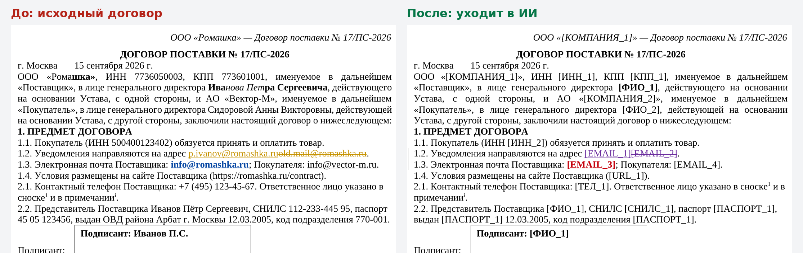
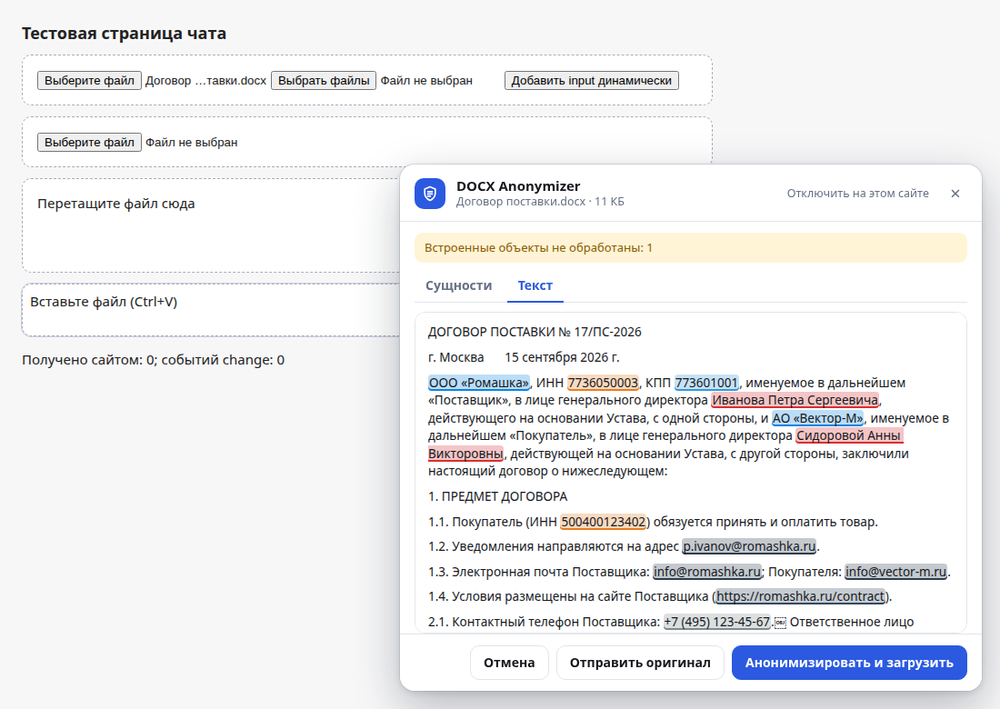
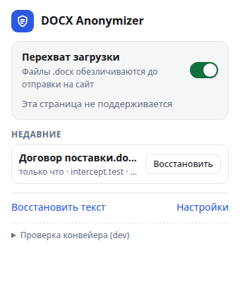
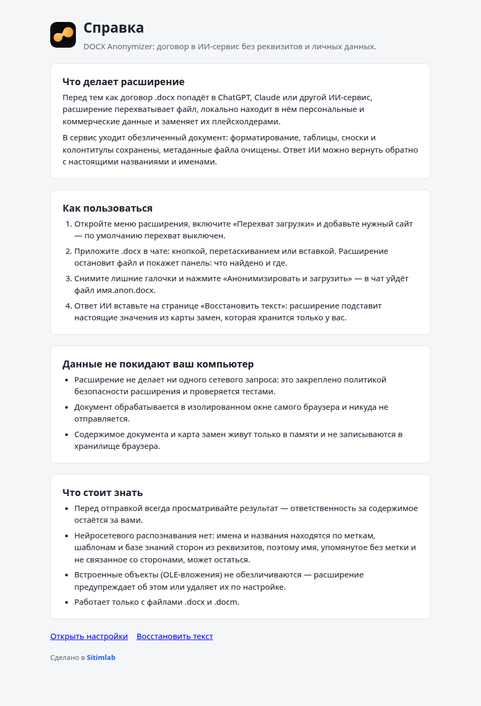
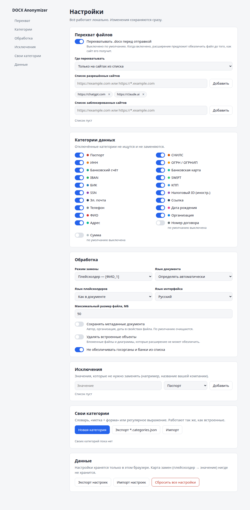
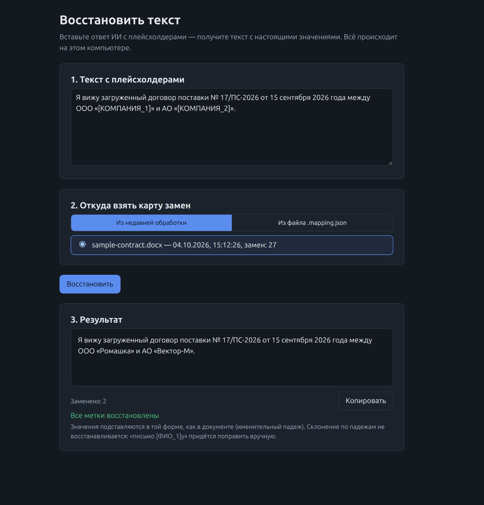

# DOCX Anonymizer

Расширение для Chrome и Edge: перед тем как договор `.docx` попадёт в ChatGPT, Claude или другой ИИ-сервис, оно **перехватывает файл, локально находит в нём персональные и коммерческие данные и заменяет их плейсхолдерами**. В сервис уходит обезличенный документ с сохранённым форматированием, а ответ ИИ можно вернуть обратно с настоящими названиями и именами.

<b>English summary</b>

**DOCX Anonymizer** is a Chrome/Edge extension that intercepts a `.docx` file the moment you attach it to ChatGPT, Claude or another AI chat, finds personal and commercial data in it **locally**, and uploads an anonymized copy instead. Formatting, tables, footnotes and headers are preserved; file metadata is wiped. The AI's answer — pasted text or a file the AI produced (`.docx`, `.md`, `.txt`) — can be de-anonymized back on the "Restore text" page using a replacement map (the recovery key) that never leaves your computer; a restored `.docx` keeps its formatting.

**What it finds.** 21 categories with checksum validation where one exists: Russian tax and registration numbers (INN, KPP, OGRN, BIK, bank accounts), IBAN/SWIFT, card numbers (Luhn), passports, SNILS/SSN, dates of birth, phones, e-mails, URLs, postal addresses, company names (Russian and Western legal forms), contract numbers and amounts, plus your own dictionaries, label+pattern rules and regular expressions. Person names are found three ways: by labels and the parties' details block, by dictionaries of first names and surnames with Russian morphology (any case, initials, transliteration), and optionally by a local NER model.

**NER model.** A compact `rubert-tiny2` fine-tuned on WikiANN ru+en, exported to ONNX int8 (30 MB) and run by onnxruntime-web (WASM) inside the extension's worker. The full release archive (`docx-anonymizer-<version>-full.zip`) already contains it and installs it on first run, with no download and no import; the lite archive leaves it out — then take the model package from [GitHub Releases](https://github.com/alexmaralless-bit/docx-anonymizer/releases) and import it on the settings page. WikiANN ru test F1: PER 0.92, ORG 0.76, LOC 0.86; cold start ≈ 0.3 s, a 20-page contract ≈ 2 s.

**Privacy.** Zero network requests: the manifest's CSP is `connect-src 'self'`, ESLint forbids `fetch`/`XMLHttpRequest`/`WebSocket` in the source, and an end-to-end test captures traffic of every browser target (pages, service worker, offscreen document and its worker) to prove nothing leaves the machine. Document contents and the replacement map live only in memory. Site access is granted per site on request (`optional_host_permissions`); nothing is injected elsewhere.

**Install.** Node.js 22+, `npm install`, `npm run build`, then load `dist/` as an unpacked extension at `chrome://extensions`. Or take a release archive: `docx-anonymizer-<version>-full.zip` (with the NER model, installs itself) or the lite `docx-anonymizer-<version>.zip`. Enable interception for a site from the extension menu and accept Chrome's access prompt.

**PDF.** A PDF with a text layer is intercepted too: pdf.js (bundled in the extension, no network) extracts the text, a layout step rebuilds paragraphs, headings, lists, two-column pages and tables and drops running headers and page numbers, and the chat receives `name.anon.md` (or `.txt`) with placeholders instead of the PDF. Scans, password-protected and empty PDFs are refused with a hint and can be uploaded as is after an explicit choice.

**Limits.** `.docx`/`.docm` and text-layer PDF only (no scans/OCR, no PDF → PDF); embedded OLE objects are not anonymized (warned about or removed); single surnames of third parties without a label are found only by the NER model; Russian case restoration skips ambiguous prepositions. The UI is Russian-first with full English localization.

**Development.** `npm test` (Vitest, ~1 450 tests), `npm run e2e` (Playwright, Chromium with the extension), `npm run lint`, `npm run pack` (reproducible release archive), `npm run pack:model`, `tools/ner-train` (Python/uv training pipeline). MIT license; dictionaries and the model carry their own permissive notices.

## Зачем

Договор — это реквизиты, ФИО подписантов, паспортные данные, счета, адреса. Загружать такое в облачную нейросеть нельзя или опасно, но разобрать договор с помощью ИИ хочется. Расширение убирает эту дилемму: ИИ видит структуру и условия, а реальные данные не покидают ваш компьютер.

## Как это работает

1. **Перехват.** Вы прикладываете `.docx` или PDF в чате (кнопкой, перетаскиванием или вставкой). Расширение останавливает файл до отправки и показывает панель: что найдено, где, с возможностью снять лишние галочки.
2. **Замена.** Нажимаете «Анонимизировать и загрузить» — в чат уходит `имя.anon.docx`: данные заменены плейсхолдерами (`[ФИО_1]`, `ООО «[КОМПАНИЯ_1]»`, `[ИНН_1]`), форматирование, таблицы, сноски и колонтитулы сохранены, метаданные файла очищены. Одно и то же значение везде получает один плейсхолдер.
3. **Восстановление.** Ответ ИИ вставляете на странице «Восстановить текст» или загружаете файлом от ИИ (`.docx`, `.md`, `.txt`) — расширение подставляет настоящие значения из карты замен (ключа восстановления), которая хранится только у вас, и склоняет ФИО по контексту.

Перед отправкой можно проверить текст документа с подсвеченными находками:

## Установка

Расширение пока не опубликовано в Chrome Web Store, оно ставится как распакованное.

1. Возьмите сборку: соберите её сами — Node.js 22+, `npm ci`, `npm run build`, появится каталог `dist/` — или распакуйте в отдельную папку архив релиза (`npm run pack`, см. ниже; архивы выкладываются в [GitHub Releases](https://github.com/alexmaralless-bit/docx-anonymizer/releases)). Архивов два:
   - **полный** `docx-anonymizer-<версия>-full.zip` (≈ 34 МБ) — с моделью NER: при первом запуске она ставится сама, ничего скачивать и импортировать не нужно;
   - **лёгкий** `docx-anonymizer-<версия>.zip` (≈ 6,1 МБ) — без модели: всё работает правилами и словарями, модель можно добавить позже (раздел «Распознавание имён моделью»).
2. Chrome → `chrome://extensions` → включите «Режим разработчика».
3. «Загрузить распакованное расширение» → выберите распакованную папку архива или `dist/`. При установке Chrome не предупреждает о доступе к данным на сайтах: расширение не получает доступа ни к одному сайту, пока вы его не выдадите (разрешения по запросу).
4. Откройте сайт чата и меню расширения, включите «Перехват загрузки» (по умолчанию выключен).
5. **Подтвердите доступ к сайту.** Для сайтов из списка по умолчанию (ChatGPT, Claude, Gemini, DeepSeek, Perplexity) нажмите в меню «Разрешить доступ», для другого сайта — «Добавить …»; Chrome спросит разрешение на доступ к этому сайту — нажмите «Разрешить». Перезагружать страницу не нужно. Сайты можно добавлять и в настройках (раздел «Перехват»): при добавлении Chrome спрашивает разрешение так же, отозвать доступ можно в `chrome://extensions` → «Сведения» → «Доступ к сайтам».

### Архив релиза

`npm run pack` собирает расширение и пакует его в `release/docx-anonymizer-<версия>.zip` — лёгкий архив (≈ 6,1 МБ, `manifest.json` — в корне архива; сеть не нужна, `dist/` не затрагивается). Если в `release/` есть пакет модели (`npm run pack:model`, см. «Распознавание имён моделью») или он указан явно (`npm run pack -- --model=<zip>`), рядом появляется полный `release/docx-anonymizer-<версия>-full.zip` (≈ 34 МБ): то же расширение плюс `models/<zip пакета>` (байт в байт, без повторного сжатия) и `models/index.json`. В полный архив попадает только пакет из списка проверенных (`src/core/ner/known-packs.js`), иначе сборка падает. Оба архива воспроизводимы: один и тот же код даёт побайтно один и тот же файл, в том числе на машинах с разными часовыми поясами; команда печатает точный размер и sha256 каждого (здесь размеры округлены, чтобы не устаревать с каждым изменением кода). Большая часть лёгкого архива — WebAssembly ONNX Runtime (`vendor/ort-wasm-simd-threaded.wasm`, 13,6 МБ, в архиве ≈ 3,6 МБ) и pdf.js. В CI модели нет — там собирается только лёгкий архив.

Порядок релиза: `npm run pack:model -- --id=<id>` → sha256 пакета в `KNOWN_PACKS` (`src/core/ner/known-packs.js`) → `npm run pack` → в Releases выкладываются три файла: полный архив, лёгкий архив и пакет модели (для тех, у кого лёгкий).

### Справка и подпись студии

В меню, настройках и на странице восстановления есть ссылка «Справка» — страница `help/help.html`: что делает расширение, как им пользоваться, что данные не покидают компьютер. Расширение сделано в [Sitimlab](https://sitimlab.ru): иконка — знак студии (`assets/sitimlab-icon.svg`, PNG 16/32/48/128 в `icons/`, пересборка — `npm run icons`), строка «Сделано в Sitimlab» со ссылкой на сайт — в меню и на страницах расширения.

## Что находится

21 категория, значения проверяются контрольными суммами там, где они есть:

- **Реквизиты:** ИНН (10 и 12 цифр), КПП, ОГРН/ОГРНИП, БИК, банковский счёт (ключ по БИК), IBAN, SWIFT/BIC, банковская карта (алгоритм Луна)
- **Личные данные:** ФИО, паспорт (серия и номер, орган выдачи, код подразделения), СНИЛС, дата рождения, SSN, налоговый ID иностранных лиц
- **Контакты:** телефон, e-mail, ссылка, адрес
- **Коммерческое:** названия организаций (ООО, АО, ПАО, ИП, LLC, Ltd, GmbH и др.), номер договора и сумма (по умолчанию выключены)
- **Свои категории:** словарь, «метка + форма» или регулярное выражение (с защитой от зависающих шаблонов)

Имена сторон из реквизитов ищутся и в других формах: падежи («Иванова», «Иванову»), инициалы («Иванов П.С.», «П.С. Иванов»), сокращённые названия, транслитерация. Государственные органы и банки из списка не трогаются.

**Словарный детектор ФИО.** Имена третьих лиц без меток («согласовано с Тимофеем Бойко», «передать Зульфие Хасановой», «Пётр Сергеевич», «agreed with Brenda Collins») находятся по словарям имён и фамилий (см. [«Словари»](#словари)) с учётом падежа и рода: нужны два признака из трёх — имя из словаря, отчество, фамилия по словарю или типичному окончанию. Все падежные формы одного человека получают один плейсхолдер. Названия фирм из «имён» («Morris International», «Clifford Chance»), топонимы («ул. Ленина») и устойчивые сочетания («Иван Купала») людьми не считаются. Выключается в настройках: «Обработка» → «Искать ФИО по словарю имён и фамилий».

## Распознавание имён моделью (NER)

Правила и словари находят большинство имён, но не все: одиночная фамилия, редкое имя или название организации без ОПФ могут остаться. Для таких случаев есть необязательный **пакет нейросетевой модели** (NER — распознавание именованных сущностей): компактная модель на базе `cointegrated/rubert-tiny2`, дообученная на WikiANN (русский и английский), находит людей, организации и места (места заменяются как адрес) без меток. Модель работает целиком на вашем компьютере (ONNX Runtime Web, WebAssembly, одна нить) и дополняет правила, а не заменяет их.

- **Где взять.** Проще всего — **полный архив** расширения `docx-anonymizer-<версия>-full.zip`: модель уже внутри и при первом запуске сама копируется из архива в хранилище браузера (около секунды; в настройках — «Встроенная модель устанавливается…», затем «проверенный пакет»). Если установка не удалась (например, архив повреждён), карточка «Модель NER» показывает «Не удалось установить встроенную модель (<код>)» и кнопку «Повторить»; импорт пакета вручную при этом доступен. Удалённая вами встроенная модель сама не возвращается — в карточке появится кнопка «Восстановить встроенную модель»; «Сбросить настройки» установленную модель не трогает. С **лёгким** архивом пакет `docx-anonymizer-ner-rubert-tiny2-ner-ruen-1.0.0.zip` (29 517 760 байт, ≈ 28 МБ) скачивается отдельно из [GitHub Releases](https://github.com/alexmaralless-bit/docx-anonymizer/releases); карточка «Модель NER» показывает три шага, меню расширения — строку со ссылкой на неё, панель на сайте — закрываемую подсказку «установите модель NER в настройках» (без ссылки: панель живёт на странице сайта). В полном архиве подсказки в панели нет. В git модели нет. Расширение ничего не скачивает из сети — ни в полном архиве, ни в лёгком.
- **Как подключить вручную** (лёгкий архив или свой пакет). Настройки → «Модель NER» → «Импортировать пакет…» и выберите zip. Расширение проверяет формат `pack.json` и контрольную сумму каждого файла; повреждённый или чужой пакет отклоняется с понятной ошибкой. Там же — тумблер «Использовать модель при анализе», порог уверенности (по умолчанию 0,7) и «Удалить модель».
- **Проверенный пакет.** Опубликованный проектом пакет имеет sha256
  `ca023f16799f08b1b1d6134fae242461bda6ab79dfe74e34eda1ec6c9a48318f` — расширение узнаёт его и показывает «проверенный пакет». Пакет, которого нет в этом списке, ставится только после подтверждения («не проверен»: целостность файлов проверена, происхождение — нет).
- **Приватность.** Файлы пакета хранятся в хранилище браузера (OPFS, разрешение `unlimitedStorage`) на этом компьютере; документы и результаты туда не записываются. Сетевых запросов нет и при работе модели. Если модель не загрузилась, анализ продолжается правилами и словарями, а панель показывает предупреждение.
- **Качество** (int8). Тест WikiANN (argmax, без порога), F1: русский — PER 0,915, ORG 0,760, LOC 0,861; английский — PER 0,809, ORG 0,652, LOC 0,772. Синтетический корпус договорных фраз (`tests/fixtures/ner/eval-{ru,en}.json`, span-F1 с точными границами): ru — PER 0,982, ORG 0,923, LOC 0,938; en — PER 0,913, ORG 0,875, LOC 0,857. Числа на синтетическом корпусе оптимистичны: в обучение входила шаблонная синтетика того же стиля, поэтому опорные — числа WikiANN. Ответы int8-модели совпадают с исходной PyTorch-моделью на 99,7 % токенов.
- **Скорость** (одна нить WASM, AMD Ryzen 9 7945HX, `npm run bench-ner`): холодная загрузка модели 0,28 с, ≈ 12 мс на окно из 128 токенов (≈ 10 000 токенов/с); договор на 20 страниц (9 016 слов) — 1,4 с на модель, ≈ 2,2 с на весь анализ в браузере вместе с правилами. `model.onnx` int8 — 30,4 МБ.
- **Собрать пакет самому:** обучение — [`tools/ner-train/`](tools/ner-train/README.md), упаковка — `npm run pack:model -- --id=<id>` из `models-src/<id>/`; формат и подробные замеры — [`docs/contracts.md`](docs/contracts.md), раздел 6.

## Словари

Словарный детектор ФИО (FR-23, ступень 1 распознавания имён) использует открытые наборы данных. Словари собираются скриптом `scripts/make-dicts.mjs` (`npm run dicts`) из закреплённых коммитов и проверяются по sha256; в расширение входят только упакованные списки (≈ 360 КБ в `offscreen/worker.js`, в content script не попадают).

| Словарь | Источник | Лицензия |
|---|---|---|
| Русские фамилии (50 000 лемм) и имена (≈ 6 800, с родом) | [datacoon/russiannames](https://github.com/datacoon/russiannames), © 2018 Ivan Begtin | BSD-3-Clause |
| Имена-омонимы нарицательных («Вера», «Роза») | [natasha/natasha](https://github.com/natasha/natasha), `maybe_first.txt` | MIT |
| Английские имена (≈ 4 900) и фамилии (10 000) | U.S. Census Bureau: 1990 Census names, 2010 Census surnames | public domain |

Полные тексты лицензий и версии источников — [`src/core/detect/names/dict/NOTICE.md`](src/core/detect/names/dict/NOTICE.md).

## PDF

PDF с текстовым слоем перехватывается так же, как `.docx`, но в чат уходит **текст с плейсхолдерами** — `имя.anon.md` (Markdown, по умолчанию) или `имя.anon.txt` (настройка «PDF с текстовым слоем» в разделе «Обработка»; там же PDF можно не перехватывать). Подставить `[ФИО_1]` во вшитые шрифты PDF нельзя, а для разбора договора ИИ нужен текст, а не вёрстка.

- Текст извлекает pdf.js (Apache 2.0) из самого пакета расширения (`vendor/pdfjs/` вместе с CMaps и стандартными шрифтами) — без сети. Разметка восстанавливает абзацы, заголовки (`#`, `##`), маркированные списки, две колонки (слева направо), таблицы (`| … |`, таблица реквизитов сохраняет строки и столбцы, суммы и количества, выровненные вправо, — свои столбцы) и переносы слов (в том числе мягкий перенос внутри номера: «ИНН 7805-» + «003215» → `7805003215`; телефоны с группами по 2–3 цифры не склеиваются); колонтитулы и номера страниц убираются, граница страниц — `---`. Альбомные страницы, сохранённые «по-принтерному» (повёрнутый лист), читаются в той ориентации, в какой видны на экране; моноширинный шрифт и надписи (врезки) LibreOffice не разрывают реквизиты.
- Находки те же, что для `.docx`: все детекторы, словари, модель NER, база знаний сторон, исключения. Карта замен и восстановление ответа — без изменений; «Скачать результат» отдаёт тот же `.anon.md`.
- Скан (на страницах нет текстового слоя), PDF с паролем, пустой и повреждённый PDF отклоняются с подсказкой; в чат такой файл уходит только после явного «Загрузить как есть». Если без текста лишь часть страниц, панель предупреждает: «Страницы N, M не содержат текста».
- PDF на 50 страниц (≈ 20 000 слов) извлекается и анализируется за ≈ 0,5 с; pdf.js загружается при первом PDF за доли секунды.

**Ручная проверка перед релизом.** Фикстуры PDF собраны из синтетических договоров Chromium и LibreOffice (`npm run gen-pdf-fixtures`, `tests/fixtures/pdf/`); PDF других генераторов по-разному хранят пробелы и порядок текста. Перед релизом откройте в панели (вкладка «Текст») договор, сохранённый в PDF из Microsoft Word, и тот же договор из LibreOffice Writer: слова не склеены, порядок абзацев верный, таблица реквизитов разбита на ячейки, колонтитулов и номеров страниц нет, в `.anon.md` нет реквизитов.

## Режимы замены

- **Плейсхолдер** — `[ФИО_1]`, по умолчанию, обратимо;
- **Маска** — буквы и цифры заменяются на `X`, разделители сохраняются (`XXXX XXXXXX`);
- **Удаление** — значение вырезается.

Категории, режим, язык плейсхолдеров, исключения и свои словари настраиваются на странице настроек:

## Восстановление ответа

Ответ ИИ с плейсхолдерами вставляется на странице «Восстановить текст». Карта берётся из недавней обработки или из файла `.mapping.json`. Нераспознанные метки подсвечиваются жёлтым.

**Файл от ИИ.** Если ИИ вернул документ, переключите первый шаг на «Файл от ИИ» и загрузите `.docx`/`.docm`, `.md` или `.txt`. Кнопка «Скачать файл» отдаёт `имя.restored.*` (`договор.anon.docx` → `договор.restored.docx`). В DOCX восстанавливаются тело, таблицы, колонтитулы, сноски, комментарии, авторы правок, поля и ссылки (адрес `https://anonymized.invalid/[URL_1]` снова ведёт на исходный сайт), форматирование сохраняется — даже если Word разбил плейсхолдер на несколько фрагментов с разным оформлением. Склонённые ФИО перечислены списком «падеж · значение в карте → подстановка» — просмотрите их. Из меню расширения «Восстановить» у недавней обработки открывает страницу сразу с этой картой.

В файле метки распознаются строго: без квадратных скобок — только точно как в карте (`ФИО_1`), поэтому «Счет 1» или «Договор 1» в тексте документа остаются как есть; в скобках подойдут и `[счет 1]`, и `[ ФИО_1 ]`. В вставленном тексте распознавание мягче. Ограничение: если под одной меткой в исходном документе были разные значения, все места получат одно. Так бывает с паспортом: под `[ПАСПОРТ_1]` хранится серия и номер, а орган выдачи и код подразделения после восстановления тоже станут серией и номером. Страница предупреждает об этом («Метка [ПАСПОРТ_1]: в документе были и другие значения») — поправьте эти места вручную.

**Ключ восстановления.** Карта замен — это ключ восстановления: она живёт только в памяти браузера до его перезапуска. На экране «готово» панели он сохраняется через «Ещё ▾» → «Сохранить ключ восстановления» (`договор.mapping.json`). Если закрыть экран, не сохранив ключ, панель один раз напомнит об этом.

**Склонение по контексту.** ФИО подставляется в нужном падеже: падеж берётся из окончания, приклеенного к метке (`письмо [ФИО_1]у` → «письмо Иванову Петру Сергеевичу»), из предлога перед ней (`от [ФИО_1]`, `в лице [ФИО_1]`, в том числе через должность: `в лице генерального директора [ФИО_1]`) или из соседней метки при перечислении (`от [ФИО_1] и [ФИО_2]`). Склонённые подстановки подсвечены зелёным, подсказка показывает падеж и значение из карты — просмотрите их. Если падеж не определить (`в`, `на`, `за`, `под`, незнакомое окончание, латиница), подставляется именительный. Карта замен при этом не меняется. Склонение отключается флажком «Склонять ФИО по контексту» на странице.

*Реальный ответ ChatGPT на демо-договор с вымышленными данными.*

## Приватность

- Ни одного сетевого запроса: политика безопасности расширения `connect-src 'self'`, ESLint запрещает в коде расширения `fetch`/`XMLHttpRequest`/`WebSocket`/`EventSource`/`sendBeacon`, e2e-тесты через CDP браузера слушают запросы всех целей — страниц, service worker, offscreen-документа и его воркера — и проверяют, что исходящих http(s)-запросов нет, в том числе при импорте и работе модели NER.
- Документ обрабатывается в изолированном окне браузера (offscreen-документ и Web Worker), никуда не отправляется.
- Содержимое документа и карта замен живут только в памяти и не записываются в хранилище браузера; в логи значения из документа не попадают.
- Пакет модели NER (встроенный из полного архива или импортированный вами) хранится в хранилище браузера на этом компьютере; документы и карта замен — нет. Встроенная модель копируется из файлов самого расширения (`chrome-extension://`), это не сетевой запрос.
- Доступ к сайтам выдаёте вы сами, по одному сайту; без доступа расширение на сайте ничего не делает.

## Ограничения

- NER-модель — **необязательный** пакет (в полном архиве уже есть, в лёгком — нет): без него имена и названия находятся правилами — по меткам («в лице», «ИНН:»), шаблонам, базе знаний сторон из реквизитов и словарям имён и фамилий. Модель тоже ошибается (см. числа выше): проверяйте результат.
- Словарь закрывает пары «Имя Фамилия», «Фамилия Имя», «Имя Отчество», но не одиночные фамилии третьих лиц («передать Бойко»): одиночную фамилию без метки находят только база знаний сторон (если это сторона договора из реквизитов) и модель NER. Редкое имя вне словаря и название организации без ОПФ и кавычек без модели могут остаться.
- При восстановлении ФИО после предлогов `в`, `на`, `за`, `под` не склоняется (падеж неоднозначен) — подставляется именительный.
- В восстановленном DOCX инициалы автора правки или комментария (`w:initials`) становятся полным именем; значения, заменённые в режимах «Маска» и «Удаление», не восстанавливаются; ФИО в косвенном падеже, получившее общий плейсхолдер, возвращается формой из карты или по правилам склонения. Восстанавливаются `.docx`/`.docm`/`.md`/`.txt`; `.xlsx`, `.pptx` и PDF от ИИ — нет.
- Файловый `input`, который страница создаёт в памяти и не добавляет в DOM (detached input), не перехватывается: расширение видит только элементы в документе. Такой приём в чатах встречается редко; e2e-тест на него есть, но отключён флагом `E2E_WP3_DETACHED`.
- Встроенные объекты (OLE-вложения) не обезличиваются — расширение предупреждает об этом или удаляет их по настройке.
- Только `.docx` / `.docm` и PDF с текстовым слоем. Рабочее пространство для пакетной обработки папок договоров запланировано.
- PDF превращается в текст, а не в обезличенный PDF: вёрстка, картинки, подписи и печати в результат не попадают. Сканы (OCR), формы PDF (поля без текстового слоя), вложения и формулы не обрабатываются. Разметка проверена на PDF из Chromium и LibreOffice; на PDF из других программ возможны склеенные слова или разорванные таблицы — просматривайте текст во вкладке «Текст» перед отправкой. Колонтитул обычного кегля, который встречается только на одной странице, распознаётся, если он отделён от текста увеличенным интервалом; иначе остаётся в тексте. Обратная сторона: первая или последняя строка страницы у самого края листа, отделённая от текста таким интервалом (не заголовок), считается колонтитулом и в результат не попадает. Таблица, разорванная границей страницы по одной-две строки, может уйти абзацем, а не таблицей.
- Нужен Chrome или Edge версии 132 и новее (pdf.js 6).
- Перед отправкой всегда просматривайте результат — ответственность за содержимое остаётся за вами.

## Разработка

CI (`.github/workflows/ci.yml`) запускается при push и pull request в `main`: lint, тесты, сборка и архив релиза, затем e2e в headless Chromium.

| Команда | Что делает |
|---|---|
| `npm test` | модульные и интеграционные тесты (Vitest, ≈ 1 450 тестов) |
| `npm run e2e` | e2e-сборка в `dist-e2e/` + e2e в Chromium с расширением (Playwright, headless) |
| `npm run lint` | ESLint |
| `npm run build` / `build:dev` | сборка в `dist/` (dev — с sourcemaps) |
| `npm run build:e2e` | сборка для e2e в `dist-e2e/`: в манифест добавлен `host_permissions: <all_urls>`, потому что нативный диалог разрешений Playwright нажать не может |
| `npm run pack` | архивы релиза: лёгкий `release/docx-anonymizer-<версия>.zip` и, если есть пакет модели в `release/` (или `-- --model=<zip>`), полный `…-full.zip` |
| `npm run pack:model -- --id=<id>` | пакет модели NER `release/docx-anonymizer-ner-<id>-<версия>.zip` из `models-src/<id>/` (детерминированный, печатает sha256) |
| `npm run dicts` | перегенерировать словари ФИО `src/core/detect/names/dict/` из закреплённых версий источников (сеть нужна только здесь); `-- --check` — сверить с закоммиченными |
| `npm run gen-fixtures` | перегенерировать документы-фикстуры `tests/fixtures/docs/*.docx` + `*.gold.json` (вымышленные данные) |
| `npm run gen-pdf-fixtures` | PDF-фикстуры `tests/fixtures/pdf/` из тех же договоров (Chromium Playwright, при наличии — LibreOffice) + `*.gold.json`; снимки разметки `*.txt` — только с `-- --update-snapshots` (`-- --snapshots-only` — пересчитать снимки из записанных PDF) |
| `npm run gen-ner-eval` | перегенерировать корпус оценки NER `tests/fixtures/ner/eval-{ru,en}.json` (вымышленные данные, фиксированный сид) |
| `npm run bench-ner` | бенчмарк и оценка NER-модели в Node: холодная загрузка, мс/окно, токены/с, F1 по классам на `eval-{ru,en}.json` (`-- --dir=<каталог модели>`, по умолчанию `models-src/rubert-tiny2-ner-ruen`) |
| `npm run icons` | иконки `icons/` из знака Sitimlab |
| `npm run sample` | образец договора `tests/fixtures/sample-contract.docx` (вымышленные стороны) |

Проект делался по спецификации: рамки первой версии — [`docs/mvp-scope.md`](docs/mvp-scope.md), цели и критерии версии 0.2 — [`docs/concept-0.2.md`](docs/concept-0.2.md), полное ТЗ — [`docs/spec-full.md`](docs/spec-full.md), контракты модулей — [`docs/contracts.md`](docs/contracts.md), рабочие пакеты — [`docs/tasks.md`](docs/tasks.md).

**Тесты на реальной модели NER** модель в git не хранят и включаются переменными окружения (в CI пропускаются):

- `NER_MODEL_DIR=models-src/rubert-tiny2-ner-ruen npx vitest run tests/integration/ner-provider.spec.js` — F1 на корпусах оценки, документ с третьими лицами, отсутствие сети;
- `npm run build:e2e && NER_PACK=release/docx-anonymizer-ner-rubert-tiny2-ner-ruen-1.0.0.zip npx playwright test ner.spec.js` — импорт пакета в настройках, анализ с моделью в воркере, время, отсутствие сети.

**Доступ к сайтам — ручная проверка.** Запрос доступа (`chrome.permissions.request`) показывает нативный диалог Chrome, его автотесты не нажимают: e2e идут на сборке `dist-e2e/`, где доступ ко всем сайтам выдан при установке. Перед релизом пройдите вручную:

1. `npm run build`, установите `dist/` как распакованное расширение; убедитесь, что при установке нет предупреждения о доступе к сайтам.
2. Откройте chatgpt.com, в меню расширения включите перехват. Сайт в списке по умолчанию, доступа ещё нет — меню показывает «Нужен доступ…» и кнопку «Разрешить доступ». Для сайта не из списка — «Добавить …».
3. Нажмите кнопку и примите запрос Chrome. Без перезагрузки страницы приложите `.docx` — появляется панель обезличивания.
4. В `chrome://extensions` → «Сведения» → «Доступ к сайтам» отзовите доступ к chatgpt.com. Меню расширения на сайте снова показывает «Разрешить доступ»; после перезагрузки страницы файл уходит без перехвата.
5. В настройках добавьте сайт в список и отклоните запрос Chrome — сайт сохраняется, под списком появляется подсказка, что доступ не выдан.

Скриншоты панели и меню снимаются e2e-тестом: `E2E_SHOTS=<каталог> npx playwright test intercept.spec.js -g скриншоты`.

## Лицензия

MIT — см. [`LICENSE`](LICENSE). Сторонние компоненты — на условиях своих лицензий:

- словари ФИО — BSD-3-Clause (datacoon/russiannames), MIT (natasha), public domain (US Census); тексты — [`NOTICE.md`](src/core/detect/names/dict/NOTICE.md);
- ONNX Runtime Web (`vendor/` в сборке) — MIT, текст — [`assets/licenses/onnxruntime-web.LICENSE`](assets/licenses/onnxruntime-web.LICENSE);
- пакет модели NER — MIT (веса дообученной модели и базовая `cointegrated/rubert-tiny2`), файлы `LICENSE` и `NOTICE` внутри пакета; данные обучения (WikiANN) в пакет не входят.
